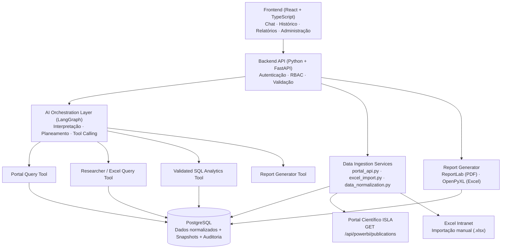
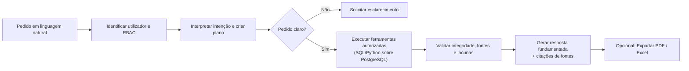
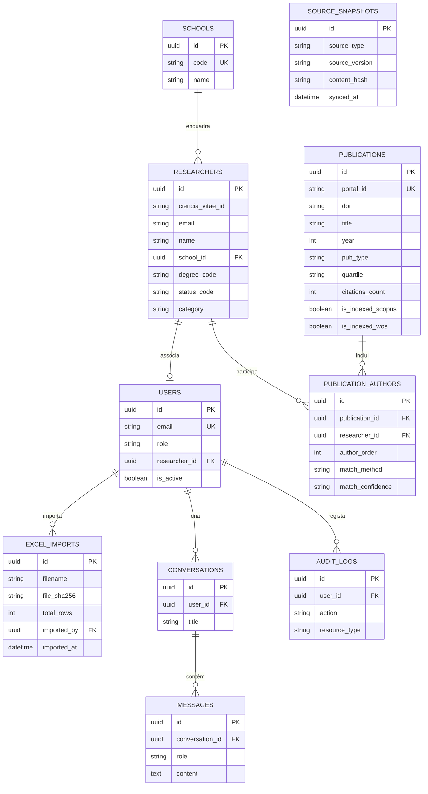

# Arquitetura Técnica — ISLA Institutional AI Agent (MVP v1.0)

## 1. Princípios Arquiteturais

1. **Separação estrita entre raciocínio (LLM) e computação (SQL/Python)**: o LLM interpreta pedidos em linguagem natural, planeia chamadas a ferramentas e redige respostas fundamentadas. Todos os cálculos, agregações e cruzamentos são executados de forma determinística no backend sobre dados estruturados em PostgreSQL.
2. **Sem dependência de Power BI Pro e sem base vetorial no MVP**: os dados iniciais (Portal Científico + Excel de docentes) são estruturados. RAG/vetores ficam reservados para a evolução P2 (documentos PDF/Word).
3. **Segurança aplicada antes do LLM**: autenticação, RBAC e filtragem por docente/campos sensíveis ocorrem exclusivamente no backend e nas queries SQL, nunca delegadas a instruções de prompt.
4. **Reprodutibilidade e rastreabilidade**: cada sincronização da API e cada importação de Excel gera um registo versionado (`source_snapshots` e `excel_imports`), permitindo reproduzir relatórios e citar exatamente as versões e datas das fontes.

## 2. Diagrama de Arquitetura

## 3. Fluxo de Execução do Agente

## 4. Modelo de Dados Relacional

## 5. Estratégia de Correspondência de Docentes (Entity Resolution)

A ligação entre publicações do Portal Científico e docentes da intranet segue uma hierarquia determinística (sem associação definitiva baseada apenas em nome):

1. **Prioridade 1 — `ciencia_vitae_id` normalizado** (`XXXX-XXXX-XXXX`, maiúsculas): associação automática com confiança `exact` (`match_method = "ciencia_vitae_id"`).
2. **Prioridade 2 — `email` institucional normalizado** (minúsculas, sem espaços): associação automática com confiança `exact` (`match_method = "institutional_email"`).
3. **Prioridade 3 — Nome normalizado**: **nunca** cria associação definitiva automática. Fica marcada como `match_method = "name_hypothesis"` com `match_confidence = "needs_validation"` para revisão administrativa ou sinalização explícita de incerteza nos relatórios.
4. **Sem correspondência na intranet**: o registo em `publication_authors` preserva os dados brutos do autor vindos do Portal (`raw_ciencia_vitae_id`, `raw_name`, `raw_email`, `raw_school`) com `researcher_id = NULL` e `match_method = "unmatched"`, garantindo que nenhuma publicação se perde nos indicadores globais.

## 6. Fases de Entrega

| Fase | Data alvo | Foco técnico |
| :--- | :--- | :--- |
| Fase 1 — Proposta científica | 15 dezembro 2026 | Problema, revisão bibliográfica, arquitetura, fontes, metodologia e plano |
| Fase 2 — Protótipo funcional | 5 janeiro 2027 | API integrada, importação Excel, BD normalizada, primeiras ferramentas e UI inicial |
| Fase final — MVP | 14 janeiro 2027 | Agente completo, cruzamento, RBAC, PDF/Excel, avaliação experimental (A/B/C) |
