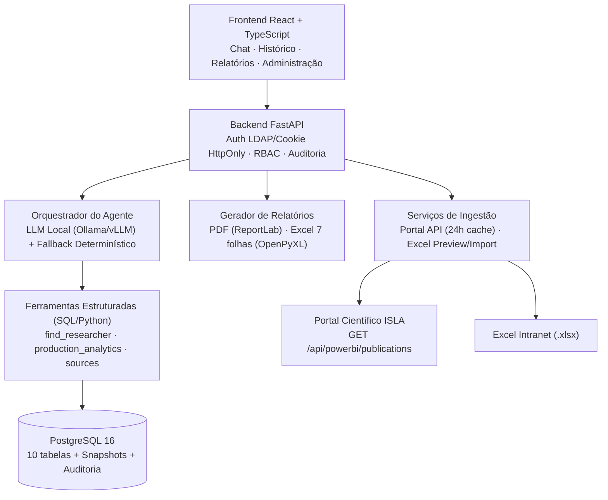

# Proposta Científica — ISLA Institutional AI Agent (Fase 1)

**Entregável**: Fase 1 — Proposta Científica (20%)  
**Data alvo**: 15 dezembro 2026  
**Âmbito**: MVP v1.0 (Dados Científicos + Dados de Docentes, sem dependência de Power BI Pro)

---

## 1. Problema e Motivação

As instituições de ensino superior mantêm informação científica e administrativa dispersa por múltiplas fontes heterogéneas — no caso do ISLA, a API do **Portal Científico** (registos bibliográficos enriquecidos com Ciência Vitae, Scopus, Web of Science e OpenAlex) e ficheiros **Excel da intranet** (enquadramento orgânico, escolas EST/ESG, graus académicos, estados e categorias de docentes/estudantes).

Responder a questões institucionais frequentes (ex.: *"produção científica da EST nos últimos cinco anos, docentes mais produtivos, publicações indexadas e evolução anual"*) exige atualmente cruzamentos manuais morosos, sujeitos a inconsistências de identificadores, duplicados e dificuldades de reprodutibilidade — acrescidos da necessidade de cumprir regras estritas de privacidade (**RGPD**), cibersegurança (**NIS2**) e controlo de acessos por perfil (**RBAC**).

## 2. Questão de Investigação e Objetivos

### Questão de Investigação
> *Em que medida um agente baseado em LLMs e ferramentas de consulta estruturada consegue interpretar pedidos pouco especificados e produzir relatórios institucionais corretos, completos e rastreáveis a partir de múltiplas fontes de dados?*

### Objetivos Específicos
1. **Integrar e normalizar** dados provenientes da API do Portal Científico e de ficheiros Excel da intranet numa base de dados relacional versionada (`PostgreSQL`), com deteção explícita de anomalias, duplicados e alterações entre sincronizações.
2. **Projetar um agente com *tool calling* estruturado** que separe estritamente o raciocínio conversacional (LLM local *on-premise*) da computação determinística (SQL/Python), solicitando esclarecimentos perante ambiguidades e recusando associações automáticas apenas por nome.
3. **Garantir segurança e soberania de dados por conceção**, aplicando RBAC (Administrador, Direção, Docente) e minimização de dados no backend antes de qualquer invocação ao LLM, com bloqueio técnico por defeito de endpoints LLM externos (RGPD/NIS2).
4. **Automatizar a geração de relatórios institucionais** em PDF (com gráficos, tabelas, fontes e limitações) e Excel (7 folhas estruturadas), suportando refinamentos iterativos na conversação.
5. **Avaliar experimentalmente** o sistema comparando três configurações (A, B e C) através de um *benchmark* reprodutível com métricas quantitativas de exatidão, rastreabilidade e segurança.

## 3. Síntese da Revisão Bibliográfica

A fundamentação teórica completa encontra-se em [revisao-bibliografica-inicial.md](literature-review/revisao-bibliografica-inicial.md), articulando:
- *Tool-Augmented LLMs* (ReAct, Toolformer) e orquestração com estado;
- Superioridade de ferramentas estruturadas (SQL/Python) face a RAG vetorial para agregações tabulares exatas e controlo RBAC (ficando o RAG vetorial reservado para a evolução P2 sobre PDFs/Word);
- Resolução determinística de entidades em bibliometria (Ciência Vitae ID e email institucional como chaves exatas; nome apenas como hipótese sujeita a validação humana);
- Conformidade RGPD/NIS2 através de LLMs locais (*Ollama/vLLM*) e cookies `HttpOnly`.

## 4. Arquitetura Proposta

A arquitetura detalhada encontra-se em [architecture.md](../docs/architecture.md), [api-integration.md](../docs/api-integration.md), [data-dictionary.md](../docs/data-dictionary.md) e [security.md](../docs/security.md).

## 5. Fontes de Dados Identificadas

| Fonte | Tipo de Integração | Principais Dados | Desafios Tratados |
| :--- | :--- | :--- | :--- |
| **Portal Científico ISLA** | `GET /api/powerbi/publications` (`Bearer`, cache 24h) | Publicações deduplicadas, autores (`;#`, `; `), DOI, quartis Q1–Q4, Scopus, WoS, citações, OA, APA | Campos multivalor heterogéneos, `Escola` por vezes vazia, anos editoriais futuros (ex.: `2027`), campos sensíveis (`Observações`, `Valor`, `Email`) |
| **Excel da Intranet** | Importação manual em duas fases (*preview* + *import*) | 121 registos (101 `Teacher`, 20 `Student`), Ciência Vitae, Escola (`EST`/`ESG`), `Grau`, `Acivo`, h-index | Erro ortográfico `Acivo`, duas colunas Ciência Vitae com divergências e pontuação extra (`)`), identificadores duplicados, códigos `Y/N/A/O` e `D/M/L/N` por confirmar |

## 6. Metodologia Experimental e Resultados Preliminares

O protocolo detalhado encontra-se em [experimental-protocol.md](methodology/experimental-protocol.md) e é executável de forma totalmente reprodutível via `research/experiments/run_benchmark.py` sobre 10 cenários sintéticos com *ground truth* (`research/test-dataset/benchmark_questions.json`).

### Resultados Preliminares no *Harness* Sintético (A vs B vs C)

| Configuração | Cenários OK | Exatidão Numérica | Completude | Fontes | Cruzamento | Ambiguidade | Relatórios | Não Fundamentadas | Fugas RBAC |
| :--- | :---: | :---: | :---: | :---: | :---: | :---: | :---: | :---: | :---: |
| **A** *(sem fontes)* | 3/10 | 0.0% | 30.0% | 0.0% | 0.0% | 50.0% | 80.0% | 0.0% | 0 |
| **B** *(só Portal API)* | 4/10 | 71.4% | 40.0% | 66.7% | 0.0% | 50.0% | 80.0% | 0.0% | 0 |
| **C** *(API + Excel + RBAC)* | **10/10** | **100.0%** | **100.0%** | **100.0%** | **100.0%** | **100.0%** | **100.0%** | **0.0%** | **0** |

Na Fase Final, o *benchmark* será alargado a perguntas adicionais validadas por especialistas do ISLA e avaliado também com o modelo LLM local em execução (`qwen2.5:7b-instruct` / `llama3.1:8b`) para medir latência, qualidade narrativa e robustez face a pedidos coloquiais.

## 7. Planeamento de Execução

| Fase | Data | Peso | Entregáveis Principais | Estado Atual |
| :--- | :--- | :---: | :--- | :---: |
| **Fase 1 — Proposta científica** | 15 dez 2026 | 20% | Problema, revisão bibliográfica, arquitetura, fontes, metodologia e plano | Concluído em rascunho técnico |
| **Fase 2 — Protótipo funcional** | 5 jan 2027 | 20% | API integrada, importação Excel, BD normalizada, ferramentas, UI inicial e código executável | Implementado e validado em CI (28 testes) |
| **Fase final — MVP** | 14 jan 2027 | 60% | Agente completo com LLM local, cruzamento, RBAC, PDF/Excel, avaliação experimental e defesa | Em validação com ambiente real PostgreSQL + Ollama |
